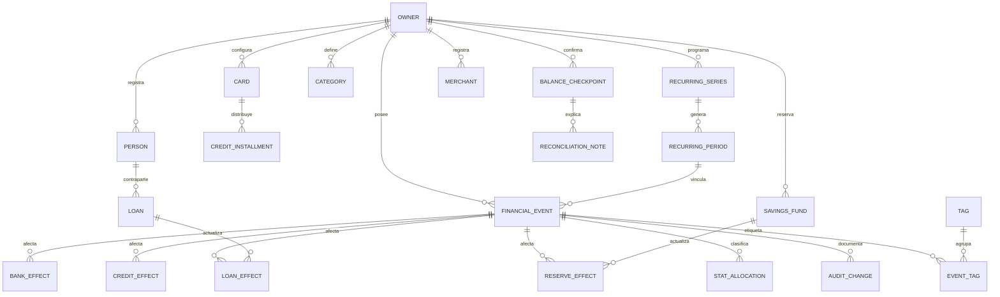

# Modelo de dominio, datos e invariantes

**Tipo:** propuesta técnica de diseño para implementar las reglas aprobadas; **no** esquema migrado todavía. La selección final de ORM, nombres físicos e índices se valida en F0. Fuente: [decisiones v9.48](../product/decisiones-producto.md), especialmente §§4–11 y §12.1.

## 1. Principios de modelado

1. **Una sola fuente de verdad por efecto real:** una compra lógica y sus efectos pueden tocar varias posiciones contables; no se representan como compras nuevas.
2. **Eventos explícitos e inmutabilidad lógica:** crear, corregir, conciliar, cobrar, pagar, aportar, reservar y devolver dejan una traza; las proyecciones pueden recalcularse.
3. **Efectos monetarios separados:** banco, deuda de crédito, derecho de cobro, deuda personal, reserva virtual y gasto/ingreso estadístico son dimensiones distintas.
4. **Aislamiento multitenant:** cada fila de dominio pertenece a un `owner_id` de Neon Auth; todas las relaciones deben comprobar que los dos lados pertenezcan al mismo titular.
5. **Importes exactos:** almacenar importe y moneda con decimal de precisión fija; no sumar cantidades de monedas distintas ni emplear `float/double` como origen contable.
6. **Fechas explícitas:** diferenciar fecha de hecho real, fecha de registro, fecha/período de referencia, fecha bancaria de acreditación, período estadístico y fecha de conciliación.
7. **Estados explícitos:** `pending` no significa `paid`; una cotización estimada no confirma obligación. Los servicios externos no aportan movimientos bancarios.
8. **Cambios retroactivos auditables:** no sobrescribir checkpoints de saldos bancarios confirmados por el usuario.

## 2. Mapa conceptual (propuesta)

Las entidades son propuestas para claridad; separar una operación en tablas o emplear una tabla general de asientos es decisión de ingeniería. **No crear automáticamente un esquema duplicado de identidad Neon Auth** ni modificar el esquema reservado `neon_auth` sin guía oficial.

## 3. Tablas conceptuales, campos y restricciones

| Entidad | Campos clave propuestos | Validaciones/relación |
|---|---|---|
| `user_preferences` | owner_id, display_currency, language, alert_preferences, version | Preferencias personales; moneda UYU/USD/EUR; default USD hasta elección. |
| `bank_currency_positions` | owner_id, currency, opening_amount, opening_at, version | **Una posición consolidada por moneda y titular**, no por banco emisor. Importes calculados/confirmados distinguidos. |
| `balance_checkpoints` | id, owner_id, currency, confirmed_amount, as_of_date, created_at, source='manual' | Ancla inmutable lógica; reemplazo solo como corrección expresamente auditada, no por cambios históricos anteriores. |
| `financial_events` | id, owner_id, kind, concept, note, effective_at, reference_period, status, idempotency_key, created_at, voided_at | Identidad de operación lógica; `kind` controlado, `status` controlado, propiedad del titular; no asumir que toda fila es gasto. |
| `bank_effects` | event_id, owner_id, currency, amount_signed, effective_at | Solo depósitos/retiros reales y ajustes fechados explícitos; reservar dinero virtual no crea esta fila. |
| `credit_cards` | id, owner_id, name, payment_rules, currencies, limit_optional, closing_day_optional | Deudas y abonos a favor separados por tarjeta y moneda; no inferir débito/crédito por nombre comercial. |
| `credit_effects` | event_id, card_id, currency, debt_delta, credit_balance_delta | Compra, abono y pago aplican consecuencias reales; nunca deuda negativa encubierta. |
| `card_statement_cycles` | card_id, period_key, estimated_amount, official_amount, min_due, due_on, closing_on, overrides | Diferenciar importes oficiales/manuales de estimados. |
| `installment_plans` | purchase_event_id, card_id, currency, installment_amount, count, first_period | Importe total calculado cuota × cantidad; partes mixtas solo en crédito; cada cuota una vez por mes. |
| `installments` | plan_id, ordinal, period_key, amount, state, original_event_id | Períodos distintos, misma compra original; reversión de cuotas solo si banco confirma cancelación. |
| `payment_allocations` | payment_event_id, statement_id?, purchase_id?, fund_id?, currency, amount | Asignaciones de pagos y fuentes deben sumar el pago total; evitar dos débitos reales. |
| `loans` | id, owner_id, person_id?, direction, currency, principal_reference?, amount_outstanding, due_at?, state | `direction`: pagar/cobrar. Los derechos por cobrar no equivalen a efectivo bancario. |
| `loan_effects` | event_id, loan_id, delta_original_currency, actual_bank_currency?, actual_bank_amount? | Pago/cobro cambia deuda y banco solo según hechos. Cobro/pago en otra moneda requiere dos importes reales. |
| `people` | id, owner_id, canonical_name, archived_at, normalized_name | Catálogo privado; no leer contactos del teléfono. |
| `merchants` | id, owner_id, canonical_name, archived_at, normalized_name | Autocompletado, alias y unificación manual reversible/auditable sin eliminar compras. |
| `categories` | id, owner_id, kind, parent_id?, name, icon?, color?, archived_at | Categorías de ingreso/gasto separadas; subcategorías opcionales; preservar referencias históricas. |
| `stat_allocations` | event_id, category_id?, currency, amount, recognition_period, allocation_kind | Un solo total real, división por categoría; `allocation_kind` distingue gasto, ingreso, y ajuste descriptivo. |
| `tags`, `event_tags` | owner_id, name, event_id, tag_id | Muchas etiquetas por evento; agregado global sin multiplicar valores por etiquetas. |
| `saved_filters` | id, owner_id, name, criteria_json, created_at | Filtros actuales con fechas absolutas o relativas, sin guardar resultados ni datos de otros usuarios. |
| `savings_funds` | id, owner_id, currency, reserved_amount, target_amount?, target_date?, status | Reservas dentro del banco consolidado; solo una moneda por fondo. |
| `reserve_effects` | event_id, fund_id, delta, effective_at | Movimiento virtual distinto de bancos; puede reservar, liberar, transferir entre fondos o cubrir gasto. |
| `fund_schedules` | fund_id, monthly_day, amount, enabled, pause_reason, starts_at | Primer aporte desde siguiente mes, insuficiencia deja pendiente, meta alcanzada pausa automático. |
| `fund_contribution_periods` | fund_id, period, planned_amount, state, actual_event_id? | Idempotencia por fondo y período; estados pendiente/omitido/completado/descartado. |
| `recurring_series` | owner_id, id, kind, concept, category_id?, currency, note?, reference_amount?, frequency, first_period, date_mode, due_day?, end_date?, paused, version | F4-01 guarda la definición inicial y usa `(owner_id, id)` como recibo de alta idempotente. `date_mode` distingue exacto, aproximado y sin fecha. La finalización se deriva después del día final inclusive. |
| `recurring_periods` | owner_id, series_id, period_index, period_key, due_on?, reference_amount?, confirmed_total?, finalized_amount?, omitted, version | Una fila por período gestionado. El estado y los importes recibidos, pagados y restantes se derivan de las asignaciones vigentes y del total confirmado. |
| `recurring_commands` y `recurring_allocations` | owner_id, series_id, id, event_id?, released_by?, command_hash, details; period_index, settlement_id, amount? | Recibos idempotentes y asignación de un movimiento a uno o varios períodos de la misma serie. Las correcciones conservan el vínculo por la cadena de auditoría. En F4-03, los cambios de programación guardan el primer índice afectado y la versión de la serie. La pausa excluye períodos nuevos hasta la reanudación. Los cambios del día habitual se aplican desde el mes siguiente y conservan las fechas de los períodos anteriores, incluidos los pendientes. |
| `recurring_shares` | period_id/series_id, person_id, amount_or_ratio | Reparto expreso entre titulares ajenos; solo materializar por cobrar al pagar gasto real. |
| `monthly_budgets` | owner_id, category_id, currency, habitual_limit, effective_from | Versionado de límites por período; padre incluye subcategorías sin doble contabilizar. |
| `budget_overrides` | budget_id, month, override_limit | Límite de un mes excepcional; siguiente mes vuelve al habitual. |
| `fx_reference_rates` | base_currency, quote_currency, observed_at, source, rate, imported_at | No sobreescribir tasa usada por un hecho histórico; fecha/tasa/fuente reproducibles. |
| `fx_valuations` | event_id, target_currency, rate_id?, manual_rate?, quoted_amount | Conversión **solo de consulta**; no mover dinero. |
| `notifications` | owner_id, type, object_id, period_key, threshold?, state, due_at | Un aviso por evento/umbral; email financiero excluido; push tarjeta opcional. |
| `audit_changes` | actor_owner_id, event_id?, entity, entity_id, change_type, before_after, created_at | Traza de correcciones, reembolsos, conciliación, edición masiva, restauración. |
| `backup_schema_versions` | version, migration_policy | Contrato de formato, no guardar contraseña de copia ni secretos. |

**Reglas técnicas:** claves foráneas y unicidad por titular; `NOT NULL` donde haya dato obligatorio; `CHECK` para importes y tipos; índices `(owner_id, effective_at DESC)`, `(owner_id, category_id)`, recurrencias `(series_id, period_key)`, notificaciones `(owner_id, type, object_id, period_key, threshold)`. Las cotizaciones pueden ser compartidas entre usuarios, pero **no** datos financieros.

El calendario muestra los períodos previstos desde `first_period`. El primer cambio explícito guarda la referencia y el vencimiento del período. Cada confirmación real usa el movimiento bancario o cargo de tarjeta existente y la fecha efectiva para estadísticas. Vincular o desvincular un movimiento registrado conserva sus efectos originales. Un importe de referencia solo es informativo. El restante se calcula cuando hay un total confirmado. Un cierre por el importe efectivamente registrado vuelve a revisión si cambia la suma por una corrección. Una anulación retira el movimiento de los importes recibidos o pagados y conserva la traza histórica.

## 4. Tipos monetarios y redondeo

- PostgreSQL: proponer `NUMERIC(20,4)` para importes y `NUMERIC(24,10)` para tipos de cambio, ajustando límites a las reglas de moneda y validando overflow; serializar decimales como **strings** entre servidor/UI.
- Cálculos en librería decimal exacta o enteros de unidades menores cuando aplicable; **no usar el tipo `number` de JS como única representación contable**. Políticas explícitas de redondeo para conversión y cuotas; no perder ni crear centésimos al dividir.
- UYU, USD y EUR se presentan con unidad y separadores locales, sin confundirse entre pesos/dólares/euros. Nunca sumar magnitudes de monedas distintas sin convertirlas según la finalidad del informe.
- Registrar monto **real exacto** en moneda bancaria; los tipos de cambio para visualización son derivados y no modifican cifras originales.
- Si las asignaciones de categoría o de método de pago tienen restos de redondeo, exigir suma exacta en la moneda correspondiente; no «ajustar» una cuenta silenciosamente.

## 5. Invariantes contables (obligatorios en dominio + tests)

**I-01 Balance bancario por moneda:** cambio bancario = suma de `bank_effects` reales confirmados en la moneda, más checkpoints explicitados; ni gastos futuros hipotéticos ni estimaciones alteran Bancos.

**I-02 Tarjeta:** cargo de compra aumenta deuda en su moneda; pago del resumen resta banco y deuda, **sin nuevo gasto**. Deuda y crédito a favor son saldos distintos. Cuotas implican periodización de consumo, no varios débitos bancarios por la misma compra.

**I-03 Reserva virtual:** reservar $X en un fondo disminuye el **disponible libre** en $X pero **no** Bancos y **no** crea gasto. Soltar reserva hace lo inverso, sin crear ingreso. Si un gasto usa reserva: **un débito bancario real**, una disminución de reserva y un solo gasto.

**I-04 Préstamo entregado/recibido:** capital prestado resta banco y crea derecho por cobrar; capital recibido aumenta banco y crea deuda por pagar. Ninguno constituye gasto/ingreso ordinario. Cobro/devolución de capital revierte respectivas posiciones.

**I-05 Gasto compartido:** pago total = parte propia + suma partes ajenas; banco registra total una vez, gasto de consumo muestra **solo parte propia**, y partes ajenas quedan por cobrar individuales. Cobro de amigos aumenta bancos y reduce cuentas por cobrar, sin crear ingresos de consumo.

**I-06 Gasto con dos medios:** suma de porciones de pago = total de compra. Las posiciones bancarias y de tarjeta reflejan **solo su parte**. La división por categorías suma el importe estadístico aplicable una sola vez.

**I-07 Ingreso dividido:** un depósito de $55.000 con asignaciones $50.000 Sueldo y $5.000 Bonificación produce **un crédito en Bancos por $55.000** y un ingreso total de $55.000, no $110.000.

**I-08 Refund entre meses (v9.42):** compra Ropa enero $2.000; devolución real febrero $500 → **enero: compra $2.000; febrero: compras Ropa no cambian por esa devolución; devolución figura separada $500; presupuesto febrero no cambia**. Banco/tarjeta acredita $500 solo al ocurrir. Los indicadores netos opcionales han de etiquetarse como tales.

**I-09 Recurrencias:** crear/avanzar período **no mueve banco**; solo confirmar pago/cobro real produce efecto. Los períodos no se duplican. Sueldos parciales vinculados se cuentan según depósitos reales, no referencia.

**I-10 Edición histórica + checkpoint:** modificar en junio gasto de febrero recalcula gasto de febrero; checkpoint de marzo **se mantiene exacto**. La diferencia de conciliación resultante es visible/registrada; **nunca** se crea gasto ficticio de compensación ni se reescribe el saldo confirmado de marzo.

**I-11 Reintentos:** una operación repetida con la misma `idempotency_key` no multiplica efectos; fallar a mitad de compra/pago no deja medias operaciones.

**I-12 Aislamiento:** `owner_id` de evento, categoría, contacto, tarjeta, fondo y toda relación debe coincidir; ninguna escritura por ID externo puede cruzar el límite.

## 6. Conciliación histórica: algoritmo técnico recomendado (F0/F1)

1. Los checkpoints almacenan **saldo confirmado y fecha**, por moneda y usuario.
2. Construir la proyección temporal desde saldos iniciales y eventos reales ordenados cronológicamente con desempate estable. Al llegar a un checkpoint, registrar **diferencia entre proyección y cantidad confirmada**, y adoptar la **cantidad confirmada como nueva ancla** para períodos posteriores.
3. Si se corrige un evento anterior a un checkpoint, recalcular proyección y métricas anteriores; **no modificar el checkpoint**. Actualizar la diferencia explicada por esa ancla, mostrando que existen eventos omitidos, errores o cambios; **nunca atribuirla automáticamente a una categoría de gasto**.
4. Proyecciones del dinero actual parten del último checkpoint más efectos reales posteriores, no de una suma corregida anterior que altere un saldo ya verificado. Mantener auditoría de correcciones.
5. Si una operación dependiente (por ejemplo, cancelación de deuda/fondo) deja invariantes imposibles tras edición retroactiva, **rechazar la mutación de forma atómica** e indicar que requiere una secuencia explícita de correcciones. No regenerar silenciosamente saldos o compromisos de terceros.
6. Probar con dos checkpoints, transacciones anuladas, monedas diferentes, reintento y eventos parcialmente registrados. Esta es una **propuesta de implementación** de la decisión 12-2A, no permiso para crear transacciones inventadas.

## 7. Máquinas de estados sugeridas

- Evento: `draft` (UI únicamente) → `confirmed` → `corrected/voided`, siempre auditado; reembolso tiene evento propio `pending` → `credited` o `cancelled`.
- Recurrencia: `active` ↔ `paused`; `finished` por fecha de término. Períodos: `expected`, `partial`, `completed`, `skipped`; no declarar saldo bancario pagado por paso de tiempo.
- Fondo: `active`, `paused_manual`, `paused_target_reached`, `closed`; aportes programados `scheduled`, `missed_insufficient`, `completed`, `discarded`.
- Deuda: `open`, `partial`, `settled`, con ajustes auditable; el tiempo no cancela capital.
- Alertas: `new` → `seen/snoozed` → `resolved`, con clave de unicidad por objeto/período/umbral.

## 8. Consistencia, autorizaciones y transacciones

- Cada operación que toca varias tablas corre dentro de **una transacción PostgreSQL** con locks o control optimista sobre posiciones relevantes; read-modify-write sin versión/lock es inseguro en dos dispositivos.
- Verificar saldo disponible y reservas **en el servidor y dentro de la transacción**, no solo en el cliente. Ningún gasto debe consumir reservas sin autorización expresa del usuario cuando corresponda.
- Las proyecciones son reconstruibles desde eventos/checkpoints/auditoría. Si se materializan vistas/saldos por rendimiento, deben actualizarse **en la misma transacción** y tener verificaciones de reconciliación.
- Fondos, tarjetas, deudas y acciones manuales requieren dos pruebas: resultado correcto cuando todo funciona y **ningún cambio** cuando algo falla.
- Política explícita de restauración: archivo de backup validado → reemplazo atómico **solo de datos financieros del mismo titular**; no sustituir cuentas de autenticación o datos de otra persona. Cifrado de copia opcional según v9.46.
- Reembolsos, cuotas, FX y saldos a favor deben comprobarse con casos reales del emisor **antes** de introducir automatismos adicionales; en excepciones usar flujos manuales y trazables.

## 9. Modelado deliberadamente NO cerrado

- Motor/ORM (Drizzle, Prisma, SQL directo), nombres de columnas y representación exacta de saldos materializados: **decisión técnica F0**, no selección del usuario.
- Cálculo estadístico de la diferencia cobrada por encima del principal original en préstamos simples con total acordado: v9.43 eligió **no exigir desglose de capital/interés**; no convertir automáticamente todo el cobro en ingreso. Documentar y probar el caso antes de exponer un indicador de rendimiento.
- Reglas excepcionales propias de cada banco (cargos internacionales, comisiones sin detalle, descuentos de cuotas distintos de datos confirmados): **no inferir**.
- Una sola persona externa puede tener múltiples deudas independientes; **no** confundir el `person_id` con la identidad del usuario autenticado.
